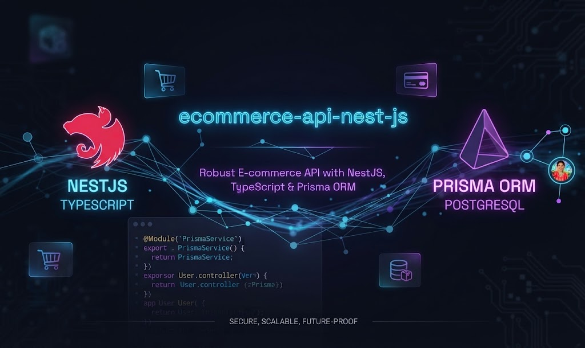

<p align="center">
  
</p>

<p align="center">
  <h1 align="center">🛒 E-commerce Backend API</h1>
</p>

<p align="center">
  API RESTful robusta e escalável desenvolvida para um ecossistema de e-commerce, focada em arquitetura limpa, segurança e alta performance.
</p>

<p align="center">
  
  
  
  
  
</p>

---

## 🚀 Sobre o Projeto

Este projeto consiste numa API backend completa construída de raiz utilizando **NestJS** e **TypeScript**[cite: 1]. O objetivo principal é fornecer uma arquitetura modular e segura para gerir um sistema de comércio eletrónico, aplicando conceitos avançados de engenharia de software, mapeamento relacional de dados com **Prisma ORM** e autenticação baseada em tokens[cite: 1].

---

## 🛠️ Stack Tecnológica

* **Framework:** [NestJS](https://nestjs.com/) (Node.js)[cite: 1]
* **Linguagem:** TypeScript[cite: 1]
* **ORM:** [Prisma ORM](https://www.prisma.io/)[cite: 1]
* **Base de Dados:** PostgreSQL (Relacional)[cite: 1]
* **Autenticação & Segurança:** Passport.js, JWT (JSON Web Tokens), Bcrypt[cite: 1]

---

## 📂 Arquitetura e Módulos do Sistema

O projeto está estruturado em módulos independentes para garantir alta coesão e baixo acoplamento:

* 🔐 **Auth & Users:** Gestão de utilizadores com encriptação avançada de palavras-passe e autenticação JWT.
* 📦 **Products:** Catálogo completo de produtos com paginação, filtros e tratamento otimizado de tipos de dados complexos (`BigInt` / Decimals), além de relações completas com Marcas, Categorias, Stocks e Imagens.
* 🎟️ **Coupons:** Sistema de validação e aplicação de cupões de desconto.
* 🛍️ **Orders:** Gestão de encomendas, fluxo de checkout e atualização de estados de pedidos.

---

## 📡 Endpoints Principais

### Autenticação & Utilizadores
* `POST /auth/login` — Autenticação de utilizador e emissão de token JWT[cite: 1].
* `POST /users` — Registo de novo utilizador[cite: 1].
* `GET /users` — Listar todos os utilizadores (Rota Protegida).
* `GET /users/:id` — Obter detalhes de um utilizador específico[cite: 1].
* `PATCH /users/:id` — Atualizar dados do utilizador[cite: 1].
* `DELETE /users/:id` — Desativar ou remover utilizador[cite: 1].

### Produtos
* `GET /products` — Listar todos os produtos ativos com relações carregadas.
* `GET /products/:id` — Obter detalhes de um produto específico[cite: 1].
* `PATCH /products/:id` — Atualizar informações do produto[cite: 1].

### Cupões & Encomendas
* `POST /coupons` — Registar novo cupão de desconto[cite: 1].
* `GET /coupons` — Listar cupões disponíveis[cite: 1].
* `POST /orders/checkout` — Realizar o checkout de uma encomenda[cite: 1].
* `GET /orders/my-orders` — Consultar encomendas do utilizador autenticado[cite: 1].
* `PATCH /orders/:id/status` — Atualizar o estado de uma encomenda[cite: 1].

---

## ⚙️ Como Executar o Projeto Localmente

1. **Clone o repositório:**
   ```bash
   git clone [https://github.com/jonathannascimento01/ecommerce-api-nestjs.git](https://github.com/jonathannascimento01/ecommerce-api-nestjs.git)
   cd ecommerce-api-nestjs